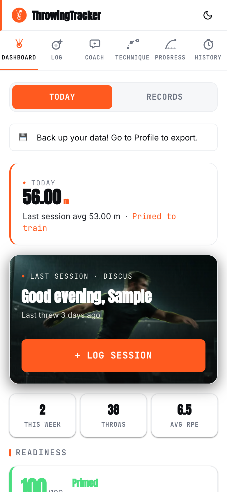
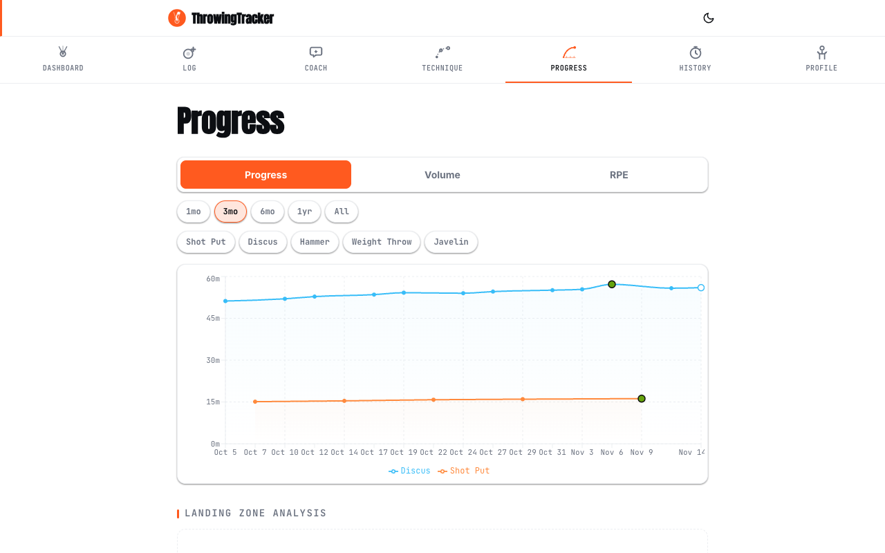
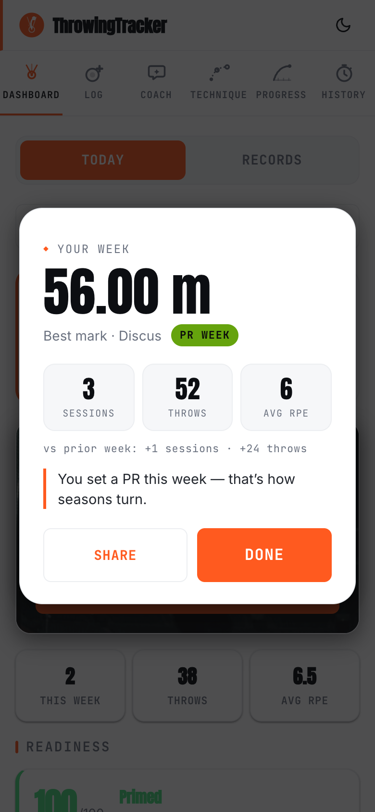
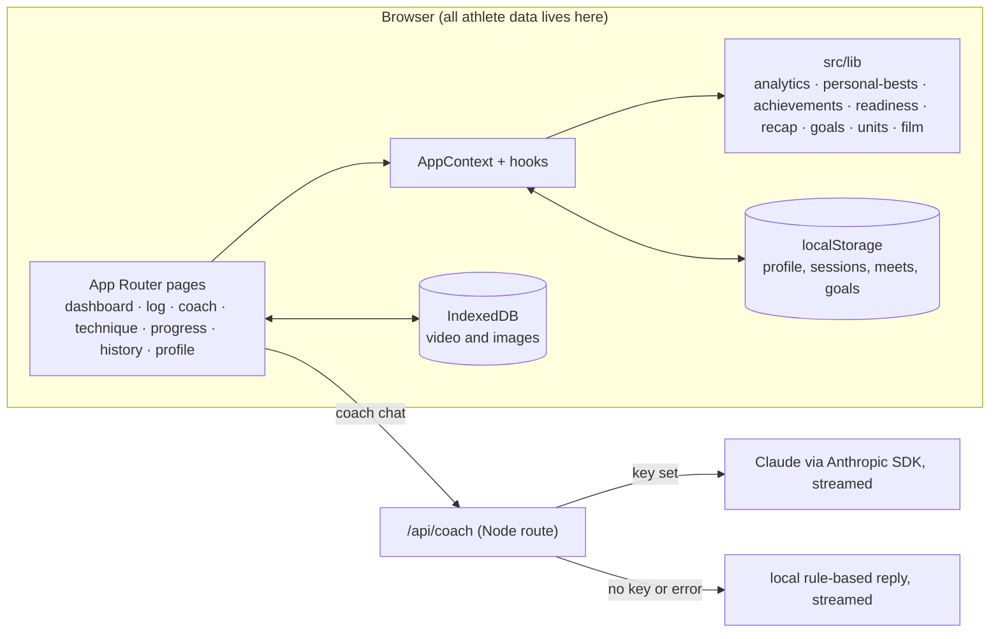

# ThrowingTracker

**A training log, progress tracker and film room for track & field throwers. Your data stays on your device.**

**[Open the app → throwing-tracker.vercel.app](https://throwing-tracker.vercel.app)** · no account, no signup

<p>
  
  
  
  
  
  
  
</p>

<table>
<tr>
<td width="34%" valign="top"></td>
<td width="66%" valign="top"><br><br></td>
</tr>
</table>
<sub>Screenshots of the live app using its built-in "Load sample data" button, so every mark shown is sample data. Captured with Playwright on 2026-11-16.</sub>

## Why this exists

Throwing events generate structured, repetitive data: distances, attempt sequences, session RPE, landing zones, competition results. Every practice and every meet produces numbers that should compound into insight over a season. In practice, they don't.

Most throwers track marks in the Notes app, a spreadsheet they abandon after two weeks, or not at all. Coaches collect data on paper heat sheets that never get digitized. Competition day means scribbling six attempts in the margins. By the time anyone asks "how has your shot put progressed since October?", the answer is a guess.

ThrowingTracker was built by a thrower to fix that.

## Features

| | |
|---|---|
| **Fast logging** | Pick an event and the implement weight, unit and RPE pre-fill from your last session of that event. Marks in metres or feet and inches. |
| **Meet Day Mode** | Six attempts, mark or foul, live best, and an animated PR alert. |
| **Progress** | Line, volume and RPE charts by event and time range, plus a PR timeline of every time your all-time best moved. |
| **Landing zones** | A canvas sector map that plots where throws land across sessions. |
| **Film Room** | Load your own video, scrub frame by frame at 0.25x to 1x, and draw on it: freehand, straight lines, and an angle tool. Video stays in IndexedDB on your device. |
| **Technique library** | Per-event key focus, phase-by-phase cues and common fault → fix pairs for shot put (glide and rotational), discus, hammer, weight throw and javelin. |
| **Coach** | A chat coach for training questions. When the server has an `ANTHROPIC_API_KEY`, a Next.js route streams answers from Claude using a prompt-cached throws-science brief; without a key it streams a local rule-based reply instead, so it never breaks. |
| **Readiness, goals and meets** | A daily readiness score, goal marks per event with progress bars, and a countdown to your next meet. |
| **Weekly recap and share cards** | A "Your Week" summary once a week, and 1080×1920 share images for PRs and recaps through the phone's share sheet. |
| **Achievements** | 16 badges across milestone, streak, competition, volume and special categories. |
| **Your data, your device** | Everything is stored in the browser (localStorage + IndexedDB). Export to JSON or CSV, and restore from a JSON backup. No accounts. |
| **Installable** | A web app manifest with PNG and maskable icons, so it can be added to a phone's home screen. |

Supported events: shot put, discus, hammer, weight throw and javelin, each with its own PRs, charts and landing patterns.

## Tech stack

Next.js 16 (App Router) · React 19 · TypeScript (strict) · Tailwind CSS v4 · Recharts · HTML5 canvas and video · localStorage + IndexedDB · `@anthropic-ai/sdk` on one server route · Vitest · Vercel. Fonts (Anton, Inter, JetBrains Mono) are self-hosted through `next/font`.

## Architecture



The coach route is the only code that runs on a server, and the only place the API key lives. Everything else is client-side.

```
src/app/          routes: /, /log, /coach, /technique, /progress, /history, /profile, /api/coach
src/components/   28 components: AppShell, DashboardTab, LogTab, MeetDayMode, FilmRoom, CoachChat, ...
src/context/      AppContext: profile, sessions, onboarding, navigation
src/lib/          pure logic with tests next to it: analytics, personal-bests, achievements, recap, goals, ...
```

## Run it locally

```bash
git clone https://github.com/Waleee7/ThrowingTracker.git
cd ThrowingTracker
npm install
npm run dev        # http://localhost:3000
```

Finish the short onboarding (name and events), or open the dashboard and press **Load sample data** to explore with six weeks of sample sessions.

The coach works without any setup in its local fallback mode. To use Claude, copy `.env.example` to `.env.local` and set `ANTHROPIC_API_KEY` (optionally `COACH_MODEL`).

## Tests

```bash
npm test
```

Last run on 2026-11-16: **107 of 107 tests passed in 15 files** (Vitest), covering analytics and streaks, personal bests, achievements, athlete level, the coach helpers, dates, export and import, film records, goals, implements, markdown, recap, throws, units and Season Wrapped.

## Data storage

| Key | Holds |
|---|---|
| `throwingProfile` | name, body stats, events, unit preference, level |
| `throwingSessions` | every training and competition session |
| `throwingMeets`, `throwingGoalMarks` | upcoming meets and per-event goals |
| `throwingFilmSessions` | Film Room records (the video itself is in IndexedDB) |
| `throwingDarkMode`, `throwingRecap*`, `throwingLastExport`, `throwingSchemaVersion` | preferences and housekeeping |

Clearing browser data deletes everything, so export regularly from Profile.

## Status

- **Live:** [throwing-tracker.vercel.app](https://throwing-tracker.vercel.app), v3.3.0. Vercel deploys `main` to production.
- **Offline:** data is stored locally, but there is no service worker yet, so the app needs a connection to load.
- See [CHANGELOG.md](CHANGELOG.md) for release history and [DEVELOPER_GUIDE.md](DEVELOPER_GUIDE.md) for internals.

## Roadmap

- A service worker so the app opens and logs with no signal at the field.
- Turn on the live coach in production (set `ANTHROPIC_API_KEY` in Vercel).
- Technique library video clips (the `TechniquePhase.video` slot is already wired).
- Optional cloud sync and a coach view for teams.

## Credits

- Built by [Akinwale Dare](https://github.com/Waleee7), a discus and hammer thrower at Life University.
- [James Olusoga](https://github.com/DareDev256) contributed the v2.0 migration to Next.js, React and TypeScript ([#1](https://github.com/Waleee7/ThrowingTracker/pull/1)) and the v3.1 broadcast redesign with the Technique Library, fast logging and the glance card ([#2](https://github.com/Waleee7/ThrowingTracker/pull/2)).
- Coach knowledge is summarized from published throws-coaching sources (for example Bondarchuk's transfer of training) and is not medical advice.

## Contributing

Pull requests are welcome, especially from throwers who code. Good areas: offline support, more events, accessibility, internationalization and tests.

## License

MIT, see [LICENSE](LICENSE).
